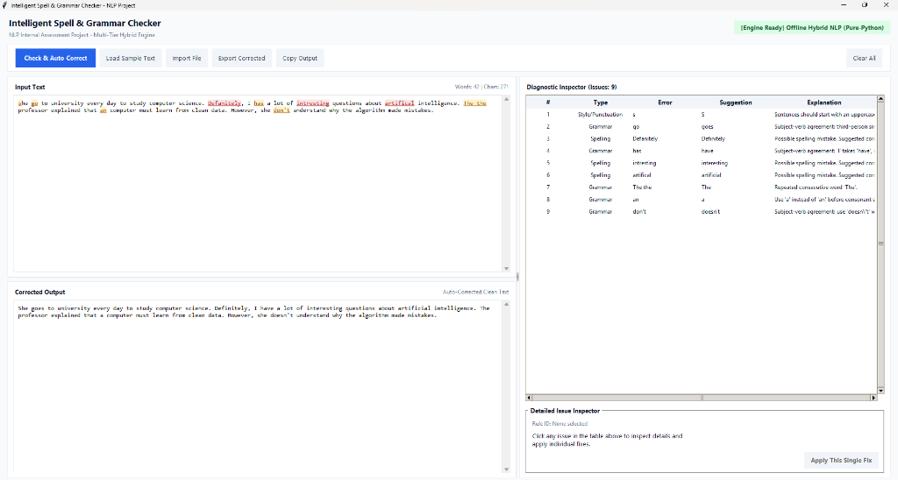

# Intelligent Spell & Grammar Checker

An offline-capable desktop application built with Python and Tkinter for intelligent spell checking, grammar correction, and style diagnostics.



---

## 📌 Features

- **Multi-Tier NLP Engine:** Combines pure-Python offline dictionaries (`pyspellchecker`), n-gram corrections (`TextBlob`), syntax heuristics, and optional LanguageTool support.
- **Visual Error Highlighting:** Highlights detected errors directly in the text editor (Red for spelling, Amber for grammar/style).
- **Interactive Diagnostic Inspector:** Displays issue numbers, error types, flagged words, suggestions, and explanations in a structured table.
- **One-Click Auto-Correction:** Instantly cleans up and rewrites the entire text in the output panel.
- **Selective Fix Application:** Inspect individual issues and apply fixes one by one.
- **Convenient Utilities:** Built-in sample text loader, `.txt` file import/export, and one-click clipboard copy.

---

## 🚀 Getting Started

### Prerequisites
- Python 3.9 or higher

### Installation

1. **Clone the repository:**
   ```bash
   git clone https://github.com/Lucifer-0612/spell_grammar_checker.git
   cd spell_grammar_checker/spell_grammar_checker
   ```

2. **Install dependencies:**
   ```bash
   pip install -r requirements.txt
   ```

3. **Run the application:**
   ```bash
   python app.py
   ```

---

## 🧪 How to Test

Follow these steps to quickly test the application:

1. **Launch the App:** Run `python app.py`.
2. **Load Sample Text:** Click the **"Load Sample Text"** button at the top to load a preset test paragraph with deliberate spelling and grammar mistakes.
3. **Analyze & Auto-Correct:** Click **"Check & Auto-Correct"**:
   - The **Input Text** panel will highlight spelling errors in red and grammar errors in amber.
   - The **Diagnostic Inspector** on the right lists every issue with its explanation and suggested replacement.
   - The **Corrected Output** panel displays the clean, corrected paragraph.
4. **Test Single Fixes:** Click any row in the **Diagnostic Inspector** table to review the rule details, then click **"Apply This Single Fix"** to replace only that error in the input text.
5. **Custom Text & File Testing:**
   - Type or paste your own custom text into the input box and click **"Check & Auto-Correct"**.
   - Use **"Import File"** to load a `.txt` file, or **"Export Corrected"** / **"Copy Output"** to save results.

---

## 📁 Project Structure

```text
spell_grammar_checker/
├── app.py             # Desktop GUI interface (Tkinter)
├── engine.py          # Multi-tier NLP spell & grammar engine
├── requirements.txt   # Required Python libraries
└── screenshot.png     # Application screenshot
```

---

## 🛠️ Built With

- **Python** (Tkinter GUI)
- **pyspellchecker** (Levenshtein distance spell checking)
- **TextBlob** (Pattern-based NLP & phrase processing)
- **LanguageTool Python** (Optional local/remote grammar engine)
