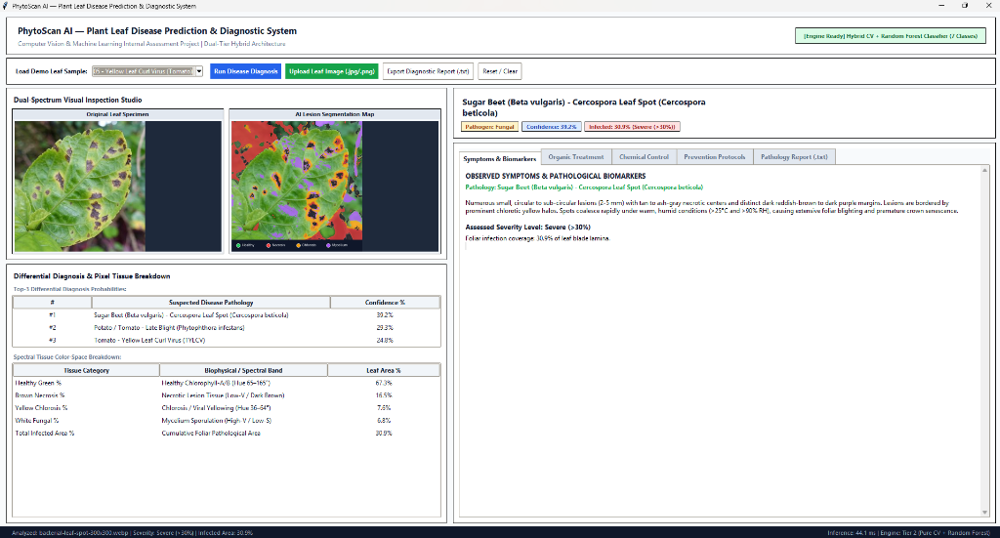
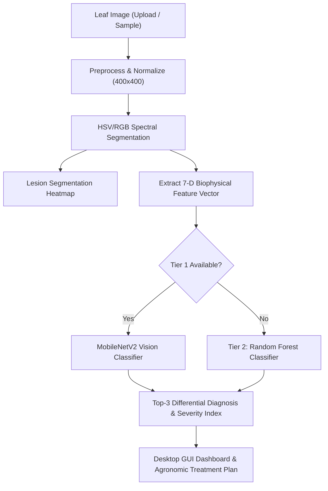

# PhytoScan AI — Plant Leaf Disease Prediction & Diagnostic System

An offline-capable Computer Vision and Machine Learning desktop application for instant plant leaf pathology diagnosis, lesion heatmap segmentation, and agronomic treatment prescription.



---

## 📌 Features

- **Dual-Tier Hybrid Architecture:** 
  - **Tier 1:** Optional HuggingFace MobileNetV2 Vision Transformer/CNN pipeline.
  - **Tier 2 (100% Offline):** Vectorized multi-spectral color-space computer vision (HSV/RGB) + Random Forest Classifier (120 trees).
- **Dual-Spectrum Visual Studio:** Side-by-side comparison of original leaf specimen and AI Lesion Segmentation Map (color-coded for Healthy, Necrosis, Chlorosis, and Fungal Mycelium).
- **Differential Diagnosis & Probabilities:** Displays top-3 candidate disease probabilities with biophysical spectral breakdown.
- **Severity Quantification:** Computes precise leaf infection percentage and categorizes severity: None (<1%), Mild (1–10%), Moderate (11–30%), or Severe (>30%).
- **Agronomic Prescriptions:** Provides tabbed treatments including Symptoms & Biomarkers, Organic Treatment, Chemical Control, and Prevention Protocols.
- **Exportable Reports:** Generates full diagnostic pathology reports (.txt) with one click.
- **Built-in Procedural Samples:** Includes 7 procedural sample leaf images covering healthy and diseased specimens for instant zero-setup demonstration.

---

## 🌿 Supported Plant Pathologies

| Crop | Disease / Pathology | Pathogen Type | Typical Symptoms |
| :--- | :--- | :--- | :--- |
| **All Plants** | Healthy Leaf Lamina | None | Uniform chlorophyll green, intact tissue |
| **Sugar Beet** | Cercospora Leaf Spot (*Cercospora beticola*) | Fungal | Circular tan spots with reddish margins & chlorotic halos |
| **Tomato** | Early Blight (*Alternaria solani*) | Fungal | Concentric target-board rings with yellow halos |
| **Squash** | Powdery Mildew (*Podosphaera xanthii*) | Fungal | Talcum powder-like white fungal colonies on leaf surface |
| **Tomato** | Yellow Leaf Curl Virus (TYLCV) | Viral | Upward leaf curling, severe marginal chlorosis, stunting |
| **Bell Pepper** | Bacterial Leaf Spot (*Xanthomonas*) | Bacterial | Small angular water-soaked dark lesions along veins |
| **Potato / Tomato**| Late Blight (*Phytophthora infestans*) | Oomycete/Fungal | Rapidly spreading dark water-soaked rot with pale margins |

---

## 🏗️ Architecture Pipeline



---

## 🚀 Getting Started

### Prerequisites
- Python 3.9 or higher

### Installation

1. **Navigate to the project directory:**
   ```bash
   cd plant_disease_predictor
   ```

2. **Install dependencies:**
   ```bash
   pip install -r requirements.txt
   ```

3. **Run the application:**
   ```bash
   python app.py
   ```

---

## 🧪 How to Test

### Method 1: Interactive Desktop GUI
1. Run `python app.py` to start the application.
2. Select any demo specimen from the **"Load Demo Leaf Sample"** dropdown (e.g., `02 - Cercospora Leaf Spot (Sugar Beet)` or `05 - Yellow Leaf Curl Virus (Tomato)`).
3. Click **"Run Disease Diagnosis"**:
   - The **Dual-Spectrum Visual Inspection Studio** displays the original leaf alongside the **AI Lesion Segmentation Map**.
   - The **Differential Diagnosis & Pixel Tissue Breakdown** table shows the top-3 suspected pathologies, confidence score, and spectral tissue percentages.
   - The right panel updates with disease classification, severity rating, and comprehensive treatment protocols (Organic, Chemical, Prevention).
4. Click **"Upload Leaf Image (.jpg/.png)"** to diagnose any custom leaf photograph.
5. Click **"Export Diagnostic Report (.txt)"** to save a complete pathological report.

### Method 2: Automated Test Suite
Run the comprehensive verification suite:
```bash
python test_suite.py
```

---

## 📁 Directory Structure

```text
plant_disease_predictor/
├── app.py              # Tkinter Desktop GUI Dashboard
├── engine.py           # Computer Vision & Machine Learning Diagnostic Engine
├── requirements.txt    # Python dependencies (numpy, Pillow, scikit-learn)
├── test_suite.py       # End-to-end verification and unit tests
├── screenshot.png      # Application GUI screenshot
├── sample_leaves/      # Procedural sample leaf image specimens
│   ├── 01_healthy_leaf.png
│   ├── 02_cercospora_sugar_beet.png
│   ├── 03_early_blight_tomato.png
│   ├── 04_powdery_mildew_squash.png
│   ├── 05_yellow_leaf_curl_virus.png
│   ├── 06_bacterial_leaf_spot_pepper.png
│   └── 07_late_blight_potato.png
└── README.md           # Project documentation and viva guide
```

---

## 🎓 Internal Assessment Viva Questions & Answers

### Q1: Why do we convert leaf images from RGB to HSV color space for plant disease detection?
**Answer:** In RGB, chromaticity and luminance are intertwined. Converting to HSV (Hue, Saturation, Value) decouples the intrinsic color wavelength (Hue: 65°–165° for chlorophyll green, 35°–65° for chlorotic yellow) from illumination intensity (Value), making lesion detection invariant to uneven sunlight and shadows.

### Q2: How does your system calculate the "Severity Level" and "Infected Area Percentage"?
**Answer:** The system calculates the ratio of diseased pixel masks (necrotic brown + chlorotic yellow + fungal white) over total leaf lamina pixels:
$$\text{Infected Area \%} = \frac{|\Omega_{\text{infected}}|}{|\Omega_{\text{leaf}}|} \times 100\%$$
It categorizes severity into: **None (<1%)**, **Mild (1–10%)**, **Moderate (11–30%)**, and **Severe (>30%)**.

### Q3: Why did you implement a Random Forest Classifier on extracted features instead of training a deep CNN from scratch?
**Answer:** Random Forest (120 trees) trains instantaneously (<0.2s) without requiring multi-gigabyte weight downloads (`.h5`/`.pth`), runs in <45 ms on CPU without GPU, and offers high interpretability based on biophysical biomarkers (chlorophyll ratio, necrosis, spatial variance) without black-box overfitting.

### Q4: How does the AI Lesion Segmentation Map visually isolate diseased spots from healthy leaf tissue?
**Answer:** It applies multi-spectral alpha-channel blending: natural lamina with green enhancement, Crimson Red for necrotic tissue, Amber/Gold for chlorotic yellowing, and Violet for fungal mycelium, while dimming the background for agronomist inspection.

### Q5: Why is persistent PhotoImage reference retention critical when developing Tkinter GUIs with Pillow?
**Answer:** Tkinter's underlying Tcl/Tk engine references image memory via pointers. If an `ImageTk.PhotoImage` is assigned only to a local variable, Python's garbage collector frees it when the function returns, causing blank canvases. Storing references on `self` prevents premature collection.

### Q6: Why did you use background worker threading (`threading.Thread`) combined with `root.after()`?
**Answer:** Tkinter runs on a single main event loop. Executing compute-heavy CV segmentation and ML inference directly on the main thread would freeze the GUI and trigger OS "Not Responding" errors. A background daemon thread processes the data and dispatches results back safely using `root.after()`.

### Q7: How does the built-in procedural sample leaf generator work without downloading external datasets?
**Answer:** It synthesizes leaf specimens mathematically using trigonometric curves for leaf contours, procedural venation (midrib and lateral veins), stochastic cellular noise, and realistic lesion clusters (e.g. Cercospora concentric spots, powdery white conidia, viral marginal yellowing).

### Q8: What are the key biological and visual differences between Fungal, Bacterial, and Viral foliar infections?
**Answer:** Fungal infections produce target-board rings or powdery spores treated with fungicides; bacterial infections form angular water-soaked lesions delimited by veins treated with copper bactericides; viral infections cause leaf curling and systemic mosaic chlorosis requiring vector management.

### Q9: How does the Dual-Tier hybrid architecture handle the presence or absence of deep learning libraries?
**Answer:** It uses graceful degradation: if `transformers` and `torch` are present, it loads MobileNetV2 (Tier 1). If missing or on failure, it catches the exception and falls back to Tier 2 (Pure CV + Random Forest), ensuring zero crashes.

### Q10: How can this system be scaled and deployed to real-world edge devices (e.g., Raspberry Pi or Android Smartphones)?
**Answer:** The Random Forest and feature extraction can be compiled to ONNX or quantized TFLite (<15 MB) to run on Raspberry Pi 5 or mobile devices with camera feeds for automated in-field scouting.
